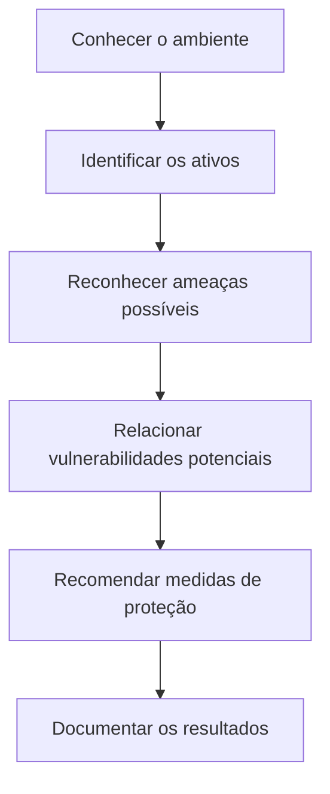

# Análise de Riscos em Cybersecurity

---

## Sobre o estudo de caso

Este estudo de caso da Cisco NetAcad mostra os riscos de segurança de uma empresa fictícia e como proteger seus dados, sistemas e equipamentos.

A Athena offers cursos online, guarda informações de alunos e pagamentos e compartilha conteúdos com parceiros. Para isso, usa computadores, servidores, bancos de dados, serviços em nuvem e acesso remoto.

---

## Desafio

Descobrir o que precisa de proteção, quais perigos podem afetar a empresa e como diminuir os riscos. Esta é uma simulação, e não uma auditoria real ou instalação de segurança.

---

## Como a análise foi organizada

1. Descobrir os bens de valor (informações, sistemas, equipamentos e rede).  
2. Ver quais ameaças podem atingir cada grupo.  
3. Sugerir formas de proteção e explicar para que servem.

---

### Dados e informações

| O que proteger | Possível ameaça | Como reduzir o risco |
|---|---|---|
| Dados pessoais dos alunos | Vazamento e roubo de identidade | Criptografar os dados e limitar quem pode acessar |
| Informações de pagamento | Roubo de dados financeiros | Criptografia e acesso restrito |
| Conteúdo dos cursos | Cópia, alteração ou acesso indevido | Autenticação forte e proteção das aplicações web |
| Arquivos enviados por parceiros | Capturar ou alteração | Conexão segura (HTTPS/TLS) e verificação de integridade |
| Informações acessadas remotamente | Exposição de dados | VPN, autenticação multifator (MFA) e permissões necessárias |

---

### Sistemas e aplicações

| O que proteger | Possível ameaça | Como reduzir o risco |
|---|---|---|
| Windows, Linux e aplicativos | Malware e exploração de falhas | Atualizações, proteção de endpoint e orientação aos usuários |
| Bancos de dados SQL | Injeção SQL e acesso indevido | Consultas parametrizadas, validação de entradas e controle de permissões |
| Sites e aplicações internas | Exploração de falhas e alteração de conteúdo | Atualizações, desenvolvimento seguro e testes de segurança |

---

### Equipamentos físicos

| O que proteger | Possível ameaça | Como reduzir o risco |
|---|---|---|
| Computadores e notebooks | Roubo, dano ou perda de dados | Criptografia de disco, backups e proteção física |
| Servidores | Falha de hardware ou energia | Backups, redundância e acesso físico restrito |
| Equipamentos de rede | Danos e acesso administrativo indevido | Proteção elétrica e restrição de acesso |

---

### Rede e conectividade

| O que proteger | Possível ameaça | Como reduzir o risco |
|---|---|---|
| DNS e demais serviços de rede | Falsificação de respostas e uso indevido | Configuração segura e filtragem adequada |
| Conexão à internet | Ataques de negação de serviço (DoS/DDoS) | Filtragem e proteção especializada contra DDoS |
| Rede cabeada e Wi-Fi | Conexões não autorizadas e interceptação | Autenticação forte, criptografia e segmentação de rede |

**Observação:** Estes são perigos possíveis e controles recomendados. O exercício não prova que a Athena sofreu ataques.

---

## Fluxo da análise

---

## Conceitos que pratiquei ao estudar o cenário

| Conceito | Em palavras simples | Exemplo |
|---|---|---|
| **Ativo** | Algo valioso para a empresa | Dados dos alunos |
| **Ameaça** | Algo que pode trazer prejuízo | Tentativa de invasão |
| **Vulnerabilidade** | Uma brecha ou fraqueza que pode ser usada | Sistema sem atualizar |
| **Risco** | Chance de acontecer X Tamanho do prejuízo | Vazamento de dados |
| **Mitigação** | Ação para diminuir o risco | Atualizar sistemas e limitar acessos |

---

## Principais aprendizados

- **Conhecer antes de proteger:** não dá para planejar a segurança sem saber quais dados, sistemas e aparelhos fazem parte da empresa.
- **Controlar acessos:** cada pessoa deve ter somente as permissões que precisa; usar confirmação em duas etapas (MFA) ajuda a evitar o uso indevido de contas.
- **Juntar várias defesas:** criptografia protege o sigilo dos dados, cópias de segurança ajudam a recuperar arquivos e atualizações consertam falhas conhecidas.
- **Anotar os riscos:** juntar o que é o alvo, o perigo e a defesa deixa a análise clara e mostra o que resolver primeiro.

Segurança não depende só de antivírus ou firewall. Também exige controlar quem entra, manter os sistemas atualizados, proteger as informações e orientar as pessoas.

---

## Relação com as áreas em que estou me desenvolvendo

- **Suporte N1:** atualizar equipamentos, orientar usuários e registrar chamados de problemas.
- **IAM (Gestão de Acessos):** cuidar de senhas, revisar permissões e dar o mínimo de acesso necessário para cada um.
- **Cybersecurity:** descobrir o que precisa ser protegido, analisar perigos e sugerir defesas.
