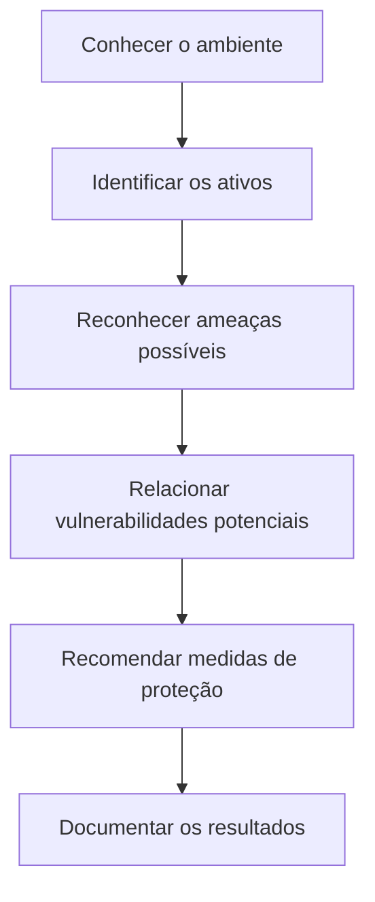

# Laboratório: Análise de Riscos em Cybersecurity

> **Laboratório educacional — Cisco Networking Academy (NetAcad)**  
> **Atividade:** Documente os problemas de segurança digital empresarial  
> **Cenário:** Athena Learning Incorporated (empresa fictícia)

## Sobre o estudo de caso

Este estudo de caso da Cisco NetAcad apresenta os riscos de segurança de uma empresa fictícia e formas de proteger seus dados, sistemas e equipamentos.

A Athena oferece cursos on-line, guarda informações de alunos e pagamentos e compartilha conteúdos com parceiros. Usa computadores, servidores, bancos de dados, serviços em nuvem e acesso remoto.

**Desafio:** identificar o que precisa ser protegido, quais ameaças podem afetar a empresa e como reduzir os riscos. Esta é uma **análise de um cenário fictício**, não uma auditoria ou implementação de segurança.

## Como a análise foi organizada

1. Identificar os ativos (informações, sistemas, equipamentos e rede).
2. Relacionar ameaças possíveis a cada grupo.
3. Propor medidas de proteção e explicar sua finalidade.

### Dados e informações

| O que proteger | Possível ameaça | Como reduzir o risco |
|---|---|---|
| Dados pessoais dos alunos | Vazamento e roubo de identidade | Criptografar os dados e limitar quem pode acessá-los |
| Informações de pagamento | Roubo de dados financeiros | Criptografia e acesso restrito |
| Conteúdo dos cursos | Cópia, alteração ou acesso indevido | Autenticação forte e proteção das aplicações web |
| Arquivos enviados por parceiros | Interceptação ou alteração | Conexão segura (HTTPS/TLS) e verificação de integridade |
| Informações acessadas remotamente | Exposição de dados | VPN, autenticação multifator (MFA) e permissões necessárias |

### Sistemas e aplicações

| O que proteger | Possível ameaça | Como reduzir o risco |
|---|---|---|
| Windows, Linux e aplicativos | Malware e exploração de falhas | Atualizações, proteção de endpoint e orientação aos usuários |
| Bancos de dados SQL | Injeção SQL e acesso indevido | Consultas parametrizadas, validação de entradas e controle de permissões |
| Sites e aplicações internas | Exploração de falhas e alteração de conteúdo | Atualizações, desenvolvimento seguro e testes de segurança |

### Equipamentos físicos

| O que proteger | Possível ameaça | Como reduzir o risco |
|---|---|---|
| Computadores e notebooks | Roubo, dano ou perda de dados | Criptografia de disco, backups e proteção física |
| Servidores | Falha de hardware ou energia | Backups, redundância e acesso físico restrito |
| Equipamentos de rede | Danos e acesso administrativo indevido | Proteção elétrica e restrição de acesso |

### Rede e conectividade

| O que proteger | Possível ameaça | Como reduzir o risco |
|---|---|---|
| DNS e demais serviços de rede | Falsificação de respostas e uso indevido | Configuração segura e filtragem adequada |
| Conexão à internet | Ataques de negação de serviço (DoS/DDoS) | Filtragem e proteção especializada contra DDoS |
| Rede cabeada e Wi-Fi | Conexões não autorizadas e interceptação | Autenticação forte, criptografia e segmentação de rede |

**Observação:** são ameaças *possíveis* e controles *recomendados*. O exercício não comprova que a Athena sofreu ataques. Algumas medidas, como MFA, HTTPS/TLS, consultas parametrizadas e segmentação, complementam os exemplos do material didático.

## Fluxo da análise

## Conceitos que pratiquei ao estudar o cenário

| Conceito | Em palavras simples | Exemplo |
|---|---|---|
| **Ativo** | Algo importante para a empresa | Dados dos alunos |
| **Ameaça** | Algo que pode causar danos | Tentativa de invasão |
| **Vulnerabilidade** | Fraqueza que pode ser explorada | Sistema desatualizado |
| **Risco** | Possibilidade de dano e seu impacto | Vazamento de dados |
| **Mitigação** | Ação para reduzir o risco | Atualizar sistemas e restringir acessos |

## Principais aprendizados

- **Identificar antes de proteger:** não é possível planejar a segurança sem conhecer os dados, sistemas e equipamentos envolvidos.
- **Proteger acessos:** cada pessoa deve ter apenas as permissões necessárias; MFA ajuda a reduzir o risco de uso indevido de contas.
- **Combinar medidas:** criptografia protege a confidencialidade dos dados, backups ajudam na recuperação e atualizações corrigem falhas conhecidas.
- **Documentar riscos:** relacionar ativo, ameaça e proteção torna a análise mais clara e facilita a definição de prioridades.

**Minha principal conclusão sobre o conteúdo:** segurança não depende apenas de antivírus ou firewall. Também envolve controle de acessos, manutenção dos sistemas, proteção dos dados e orientação das pessoas.

### Relação com as áreas em que estou me desenvolvendo

- **Suporte N1:** atualização de equipamentos, orientação a usuários e registro de incidentes.
- **IAM:** autenticação, revisão de permissões e princípio do menor privilégio.
- **Cybersecurity:** identificação de ativos, análise de ameaças e recomendação de controles.

