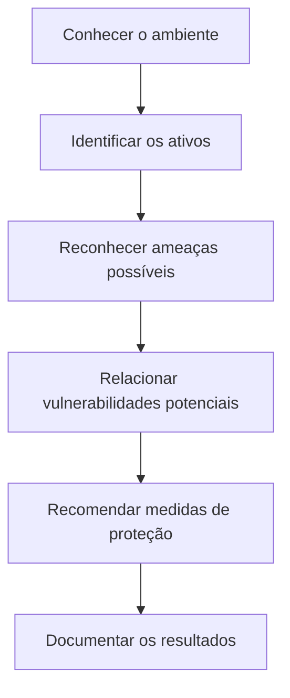

# Laboratório Cisco Networking Academy: Análise de Riscos em Cybersecurity

> **Atividade:** Documente os problemas de segurança digital empresarial  
> **Cenário:** Athena Learning Incorporated (empresa fictícia)

## Sobre o estudo de caso

Este estudo de caso da Cisco NetAcad mostra os riscos de segurança de uma empresa de mentira e como proteger seus dados, sistemas e equipamentos.

A Athena offers cursos online, guarda informações de alunos e pagamentos e compartilha conteúdos com parceiros. Para isso, usa computadores, servidores, bancos de dados, serviços em nuvem e acesso remoto.

## Desafio

Descobrir o que precisa de proteção, quais perigos podem afetar a empresa e como diminuir os riscos. Esta é uma simulação, e não uma auditoria real ou instalação de segurança.

## Como a análise foi organizada

1. Descobrir os bens de valor (informações, sistemas, equipamentos e rede).  
2. Ver quais ameaças podem atingir cada grupo.  
3. Sugerir formas de proteção e explicar para que servem.

---

### Dados e informações

| O que proteger | Perigo possível | Como reduzir o risco |
|---|---|---|
| Dados pessoais dos alunos | Vazamento e roubo de identidade | Criptografar e limitar quem pode ver |
| Informações de pagamento | Roubo de dados de dinheiro | Criptografia e acesso restrito |
| Conteúdo dos cursos | Cópia, mudança ou acesso sem permissão | Senha forte com confirmação e proteção dos sites |
| Arquivos enviados por parceiros | Pegar no meio do caminho ou alteração | Conexão segura (HTTPS/TLS) e checagem de integridade |
| Informações acessadas de longe | Exposição de dados | Rede privada (VPN), confirmação em duas etapas (MFA) e permissões certas |

---

### Sistemas e aplicações

| O que proteger | Perigo possível | Como reduzir o risco |
|---|---|---|
| Windows, Linux e programas | Vírus (malware) e falhas nos sistemas | Atualizações, proteção nos aparelhos e orientação aos usuários |
| Bancos de dados SQL | Ataques de injeção de código e acesso indevido | Consultas seguras, checagem de dados e controle de quem pode entrar |
| Sites e sistemas internos | Explorar falhas e mudar conteúdos | Atualizações, criação segura de programas e testes de segurança |

---

### Equipamentos físicos

| O que proteger | Perigo possível | Como reduzir o risco |
|---|---|---|
| Computadores e notebooks | Roubo, quebra ou perda de dados | Criptografia no disco, cópias de segurança (backups) e proteção física |
| Servidores | Pane nas peças ou falta de luz | Cópias de segurança, peças reservas e acesso físico controlado |
| Aparelhos de rede | Danos e acesso de pessoas não autorizadas | Proteção contra queda de luz e bloqueio de acesso |

---

### Rede e conexão

| O que proteger | Perigo possível | Como reduzir o risco |
|---|---|---|
| DNS e outros serviços de rede | Falsificação de respostas e uso incorreto | Boa configuração e filtros adequados |
| Conexão com a internet | Ataques para derrubar o sistema (DoS/DDoS) | Filtros e proteção especial contra quedas |
| Cabo de rede e WiFi | Acessos não autorizados e pegar dados no meio do caminho | Senhas fortes, criptografia e divisão da rede |

**Observação:** Estes são perigos possíveis e controles recomendados. O exercício não prova que a Athena sofreu ataques.

---

## Fluxo da análise

## Conceitos que pratiquei ao estudar o cenário

| Conceito | Em palavras simples | Exemplo |
|---|---|---|
| **Ativo** | Algo valioso para a empresa | Dados dos alunos |
| **Ameaça** | Algo que pode trazer prejuízo | Tentativa de invasão |
| **Vulnerabilidade** | Uma brecha ou fraqueza que pode ser usada | Sistema sem atualizar |
| **Risco** | Chance de acontecer X Tamanho do prejuízo | Vazamento de dados |
| **Mitigação** | Ação para diminuir o risco | Atualizar sistemas e limitar acessos |

## Principais aprendizados

- **Conhecer antes de proteger:** não dá para planejar a segurança sem saber quais dados, sistemas e aparelhos fazem parte da empresa.
- **Controlar acessos:** cada pessoa deve ter somente as permissões que precisa; usar confirmação em duas etapas (MFA) ajuda a evitar o uso indevido de contas.
- **Juntar várias defesas:** criptografia protege o sigilo dos dados, cópias de segurança ajudam a recuperar arquivos e atualizações consertam falhas conhecidas.
- **Anotar os riscos:** juntar o que é o alvo, o perigo e a defesa deixa a análise clara e mostra o que resolver primeiro.

**Minha principal conclusão sobre o conteúdo:** segurança não depende só de antivírus ou firewall. Também exige controlar quem entra, manter os sistemas atualizados, proteger as informações e orientar as pessoas.

## Relação com as áreas em que estou me desenvolvendo

- **Suporte N1:** atualizar equipamentos, orientar usuários e registrar chamados de problemas.
- **IAM (Gestão de Acessos):** cuidar de senhas, revisar permissões e dar o mínimo de acesso necessário para cada um.
- **Cybersecurity:** descobrir o que precisa ser protegido, analisar perigos e sugerir defesas.
